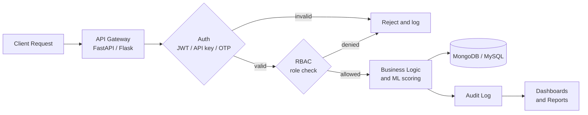

<div align="center">


<a href="https://git.io/typing-svg"></a>

<br/>

[](https://linkedin.com/in/durvesh-patil-188514281)
[](mailto:durvesh.patil555@gmail.com)


</div>


## ⚡ Impact at a Glance

<div align="center">

| 🎯 **384** | 🔎 **96** | 🚨 **150+** | 🧩 **10+** | 🌐 **30** | 🎓 **9.32** |
|:---:|:---:|:---:|:---:|:---:|:---:|
| attacker-like activities analyzed | review cases investigated | alerts triaged in my SOC platform | MITRE ATT&CK techniques mapped | network paths validated | CGPI, B.E. Computer Eng. |

| 🔌 **5+** | 🗃️ **4** | 🏢 **15+** | ✅ **10+** | 📨 **50+** | 🧪 **7** |
|:---:|:---:|:---:|:---:|:---:|:---:|
| REST APIs shipped | MongoDB collections designed | targets in attack-surface analysis | security findings validated | phishing interactions analyzed | zones in my detection lab |

</div>


## 👨‍💻 whoami

```bash
$ whoami
durvesh_patil

$ cat profile.json
{
  "role":      ["Backend Engineer", "Security Engineer", "SOC Analyst"],
  "education": "B.E. Computer Engineering @ SPPU (June 2027), CGPI 9.32",
  "currently": "SOC Analyst Intern @ T.R.A.N.",
  "builds":    "authenticated, database-backed REST APIs and AI-driven apps",
  "secures":   "everything I build, using JWT, RBAC, 2FA and audit logging",
  "cloud":     ["AWS EC2", "S3", "IAM", "RDS"],
  "hiring":    "open to Backend and Security roles"
}
```

> I work where **backend engineering meets cybersecurity**. I've worked as a SOC analyst and penetration tester, so I know how APIs get attacked, and I build mine to resist it.


## 🛠️ Tech Arsenal

### ⚙️ Backend and Cloud

<p>

</p>


### 🛡️ Cybersecurity


### 🧰 Security Tools


## 🚀 Featured Projects

### 🛡️ AI SOC Analyst Assistant
*An intelligent security incident analysis platform.*

A centralized SOC investigation platform for **150+ simulated alerts**, covering triage, case assignment, investigation tracking and analyst history.

| ⚙️ Backend | 🛡️ Security |
|---|---|
| 5+ REST APIs for alert ingestion, auth, case management, incident tracking and reports | Alert enrichment mapped to **10+ MITRE ATT&CK techniques** |
| Role-based access control | Severity assessment and remediation recommendations |
| **4 MongoDB collections**: audit logs, analyst notes, incident timelines, searchable records | Full audit trail of analyst actions |

### 🎣 PhishNet AI
*A phishing email detection system.*

An end-to-end platform that scores email content from **0–100% risk**, with a dashboard of 7-day phishing trends and downloadable PDF/CSV reports.

| ⚙️ Backend | 🛡️ Security |
|---|---|
| Authenticated REST APIs with scan history and user feedback | **OTP-based 2FA** and API-key protection |
| Prediction history and admin controls | Password hashing, audit logging, role-based controls |

### 🧠 How I design a secure backend




## 💼 Experience

### 🔹 SOC Analyst Intern · The Root Access Network (T.R.A.N.)
*Jun 2026 – Aug 2026 · Remote*

- 🔍 Analyzed authentication and security logs to identify suspicious activity, **IOCs** and potential incidents
- 🧬 Correlated authentication, DNS, web, firewall and endpoint telemetry across **3+ schema versions**
- 🎯 Hunted across **384 attacker-like activities** and **96 review cases**
- 📜 Produced **STIX 2.1, Sigma and Suricata** detection content
- 🌐 Built a **7-zone network detection lab** (containerlab, FRRouting, nftables) and validated **30 network paths**
- 🧨 Assessed JWT weaknesses, SQL injection, XXE and insecure password storage
- 📋 Wrote risk assessments, incident reports and **30/60/90-day security roadmaps** aligned with **NIST, ISO 27001 and MITRE ATT&CK**

### 🔹 Cybersecurity Intern · The Drop Organization
*Jul 2025 – Aug 2025*

- 🛰️ OSINT and attack-surface analysis across **15+ targets**
- 🔓 Validated **10+ security findings** through scanning and manual penetration testing
- 🎣 Analyzed **50+ simulated phishing interactions** and wrote risk-prioritized vulnerability reports


## 🏅 Education and Certifications

| | |
|---|---|
| 🎓 **B.E. Computer Engineering** | Sinhgad Institute of Technology and Science (SPPU), **CGPI 9.32 / 10**, June 2027 |
| 🐍 **Python and Machine Learning** | IIT Bombay (Spoken Tutorial) |
| ⚙️ **C++ Training** | IIT Bombay (Spoken Tutorial) |
| 🛡️ **Defensive Cyber Security Course (DCSC)** | The Drop Organization |
| 💼 **Cyber Job Simulation** | Deloitte Australia (Forage) |


## 📊 GitHub Activity

<div align="center">


</div>


<div align="center">

## 📫 Let's Build Something Secure

I'm open to **Backend Engineer, Security Engineer, SOC Analyst and VAPT** roles.

[](https://linkedin.com/in/durvesh-patil-188514281)
[](mailto:durvesh.patil555@gmail.com)

*"Good backend engineers build systems that work. Great ones build systems that hold up under attack."*


</div>
